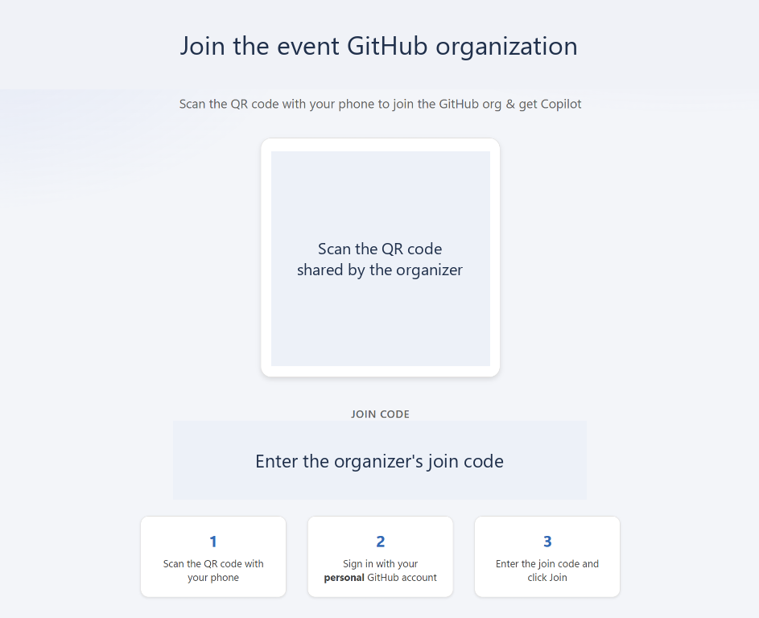

# Manufacturing workshop: from machine-fault evidence to a pilot

**Bengaluru local time:** Monday and Tuesday 09:30–16:00; Wednesday 09:30–14:00.

## Prerequisites and downloads

Complete these checks on the laptop you'll use for the workshop. Fabric and GitHub are separate sign-ins.

### 1. Check your Fabric access

1. Bring your laptop and charger. Open [Microsoft Fabric](https://app.fabric.microsoft.com/) in Edge or Chrome and sign in with the **work or school account that was granted Fabric access**. Use the organizer's tenant and workspace link. Check Teams separately if your group is using it.
2. In the workshop workspace, open **New item**. Check that **Lakehouse** and **Eventhouse** are available. You don't need to create test items before class. At least one person per team needs permission to create and edit items in a workspace on active Fabric capacity.
3. If the workspace is missing, check that you're using the invited account and the right tenant. If you can view but not create items, pair with a teammate who has edit access. Use the lab's fallback if a feature such as model editing, Data Agent, ontology, or Operations Agent is unavailable.
4. Keep the same workspace and item names on Day 2. No VS Code, Power BI Desktop, or report authoring is required for the Fabric labs. Day 3 is facilitator-led; participants don't need a Foundry account or Azure subscription.

### 2. Download and check the workshop data

1. Create a folder you can find easily, such as `Downloads\FabricWorkshop`.
2. Save both files below into that folder. If a link opens as plain text, use **Save As** (`Ctrl+S`) or right-click the link and choose **Save link as**. Keep the exact `.csv` filenames, not `.csv.txt` or `.xlsx`.

   | Download | What it contains | Where you'll use it |
   |---|---|---|
   | [plants.csv](../data/plants.csv) | 3 plant records; look for `PlantId` and `PlantName` | Day 1 Lakehouse |
   | [machine_events.csv](../data/machine_events.csv) | 500 event records; look for `EventTime`, `PlantId`, `MachineId`, `EventType`, and `Severity` | Day 1 Lakehouse **and** Eventhouse |

3. Open each file in a plain-text editor to confirm the first line contains comma-separated column names, not an HTML page. Close without editing. The counts above exclude the header row.
4. Wait for the Day 1 lab to upload the files. They contain synthetic data; you don't need to clean them, connect to SAP, or bring real plant data.

### Get GitHub Copilot access

The screenshot shows the event join page. Get the **scannable QR code and active join code** from the organizer at the event or in the private attendee channel; the public screenshot masks them.



1. **Choose your GitHub account.** The event join page asks for a **personal GitHub account**. If you want to use a **Bosch-managed GitHub account**, use it only if the organizer confirms it is supported for this event. Your Bosch work email or Fabric sign-in alone is not a GitHub account. If a different GitHub account is already signed in, switch accounts before joining.
2. **Open the join page.** Scan the organizer's QR code with your phone. If you can't scan it, ask for the private join link and open it on your laptop.
3. **Sign in and join.** Sign in to GitHub with the account you chose, enter the organizer's current join code, and select **Join**. If GitHub sends an organization invitation, accept it using the **same GitHub account**.
4. **Check Copilot access.** On your laptop, sign in to GitHub with that same account and open [GitHub Copilot settings](https://github.com/settings/copilot). If the event access doesn't appear, send the organizer your **GitHub username** privately so they can check the invitation and seat assignment. Don't share a password or verification code.

**Ready to start?** One teammate should be able to create Fabric items, and the team should have both CSVs. If something is blocked, tell the facilitator privately which step failed and the exact error. Use the prepared Fabric item or evidence card if needed. You can start the Fabric labs while Copilot access is pending. Rotate who builds, checks the results, and records the evidence.

## What we're solving — problem and architecture

You're taking over a factory shift. Two machines have repeated faults, and maintenance can review only one first. **Which machine should maintenance review first, and what evidence supports your choice?**

Compare how often each machine reported a fault and how severe those faults were. Your team will hand over a short recommendation: **one machine, the numbers behind your choice, and what the data doesn't tell you.** The data can help prioritize a review; it cannot prove what caused the faults or which orders were affected.

### How the data flows

```text
Day 1 | Load and check the data in Fabric
  Both CSV files -----> Lakehouse: check the tables with SQL
  Machine events -----> Eventhouse: query events and build a dashboard

Day 2 | Reuse the same workspace and data
  Lakehouse  -> Semantic model --------------------+
  Eventhouse -> Data Agent and fault-rule replay --+
                                                   v
                               Evidence card: one machine and why

Day 3 | Use the evidence to plan a small pilot
  Evidence card -> Foundry walkthrough -> Pilot scope and next steps
```

The event file is loaded twice on purpose: the Lakehouse copy supports the model, and the Eventhouse copy supports event queries, the dashboard, and the agent exercises. Day 3 uses the **evidence card**, not a live connection to Foundry.

## Day 1 — Build the data assets in Fabric

| Time | Activity | What you leave with |
|---|---|---|
| 09:30–10:00 | Welcome and the maintenance problem | A shared decision and list of evidence needed |
| 10:00–10:45 | Fabric concepts: workspace, OneLake, Lakehouse, and Eventhouse | A map of where files, tables, and telemetry live |
| 10:45–11:00 | Break | |
| 11:00–11:30 | Facilitator demo: from file to table and query | A working example to follow |
| 11:30–12:30 | Lakehouse build and SQL validation | Two queryable tables and a plant-level quality check |
| 12:30–13:15 | Lunch | |
| 13:15–14:30 | Eventhouse build and guided KQL | One KQL database and three verified results |
| 14:30–14:45 | Break | |
| 14:45–15:35 | Independent investigation and Real-Time Dashboard | A maintenance dashboard or saved query results |
| 15:35–16:00 | Show what you built and save the Day 2 handoff | Workspace/item names and reproducible evidence |

### 09:30–11:30 — Understand the flow before building

- **Frame the decision:** Ask what a shift lead needs to know before recommending a maintenance review. Agree that repeated faults and High severity are evidence for priority, not proof of root cause.
- **Explain the Fabric items:** A workspace holds the items; OneLake stores the Lakehouse data; the Lakehouse makes files queryable as tables; the Eventhouse KQL database is the event-analysis copy. Briefly show where semantic models and agents fit tomorrow. No second scenario or tool setup is needed.
- **Demonstrate:** Show `plants.csv` as a file, then as a table. Show the separate KQL database and a row-count query. Explain why the same telemetry CSV is loaded twice: the Lakehouse copy feeds the semantic model, and the KQL copy feeds the agents.

### 11:30 — Build the Lakehouse

1. **Guided (15 min):** Choose **New item > Lakehouse**, name it `MaintenanceLH_<Team>`, and keep Lakehouse schemas enabled. In **Files**, upload `plants.csv`. From the file's **More options**, select **Load to Tables > New table**. Keep `dbo`, name it `plants`, and keep the comma separator and header option enabled. Open **Tables > dbo > plants**. Check `P01`, `P02`, and `P03`.
2. **Build independently (20 min):** Repeat with `machine_events.csv`, naming the table `machine_events`. Identify `EventTime`, `PlantId`, `MachineId`, `EventType`, and `Severity`. Make sure both tables appear under **Tables**, not only **Files**. If an import is pending or throttled, don't repeatedly upload it; use the prepared Lakehouse.
3. **Validate in SQL (25 min):** Switch the Lakehouse to its **SQL analytics endpoint**, open **New SQL query**, and run the query below. The endpoint lets you query the same tables without copying them or changing the source data. Predict whether Plant East will appear before running. Then change `LEFT JOIN` to `INNER JOIN` and explain the difference to a teammate.

   ```sql
   SELECT p.PlantId, p.PlantName, COUNT(e.PlantId) AS FaultCount
   FROM dbo.plants AS p
   LEFT JOIN dbo.machine_events AS e
       ON e.PlantId = p.PlantId
       AND e.EventType = 'Fault'
       AND e.EventTime >= '2026-11-01T00:00:00'
       AND e.EventTime <  '2026-11-11T00:00:00'
   GROUP BY p.PlantId, p.PlantName
   ORDER BY p.PlantId;
   ```

   **Check:** North 8, South 8, East 0. The inner join drops East. If tables are still syncing or the SQL endpoint is unavailable, use the prepared endpoint or group the CSV and retain all three plants from the lookup.

   **Fast finish:** Reverse the join: start from `machine_events`, left join `plants` on `PlantId`, and count rows where `p.PlantId IS NULL`. Expect zero unmatched events. Explain how an unmatched event could affect a plant filter in tomorrow's model.

### 13:15 — Build and query Eventhouse

1. **Set up (25 min):** Choose **New item > Eventhouse**, name it `MaintenanceEvents_<Team>`, and open its KQL database. Select **Get data > Local file > New table**. Upload `machine_events.csv`, name the table `machine_events`, choose CSV with **First row header**, and confirm `EventTime` is datetime. Finish and wait. If using a prepared KQL database, skip the upload. Do not ingest twice.
2. **Query (35 min):** Open **Query > Query with code**. Paste one block per tab and select **Run**. Write down the UTC window, filters, and each result.

   ```kusto
   machine_events
   | count
   ```

   ```kusto
   machine_events
   | where EventTime >= datetime(2026-11-01) and EventTime < datetime(2026-11-11)
   | where EventType == "Fault"
   | summarize FaultCount = count() by PlantId, MachineId
   | where FaultCount >= 3
   | order by FaultCount desc, MachineId asc
   ```

   ```kusto
   machine_events
   | where EventTime >= datetime(2026-11-01) and EventTime < datetime(2026-11-11)
   | where Severity == "High"
   | project EventTime, PlantId, MachineId, EventType
   | order by EventTime asc
   ```

3. **Check (15 min):** Expect 500 rows; 8 faults per qualifying machine; and 6 High events, all on `MC-N01`. The severity query does not filter on `EventType`. If KQL is unavailable, filter the CSV or use the evidence card and explain how the results would be reproduced.

### 14:45 — Investigate, build a dashboard, and hand off

- **Independent investigation (20 min):** Copy the repeated-fault query into two new tabs. Change the first window to November 1–5 inclusive (`< datetime(2026-11-06)`) and the second to November 6–10 inclusive (`>= datetime(2026-11-06)`). Predict the results, then verify both machines go from five to three faults.
- **Build a Real-Time Dashboard (30 min):** In a [KQL queryset](https://learn.microsoft.com/en-us/fabric/real-time-intelligence/dashboard-real-time-create) connected to your Day 1 database, run the original repeated-fault query and choose **Save to dashboard > To a new Dashboard**. Name it `MaintenanceReview_<Team>`. Run the High-severity query in another tab and save it to that dashboard as a second tile. Name the tiles **Repeated faults** and **High-severity events**. Verify two groups in the first tile and six events in the second. This is a Fabric Real-Time Dashboard, not a Power BI report or a live feed. If dashboard creation is unavailable, keep the two results in named query tabs or private team notes.
- **Handoff (25 min):** Ask a teammate to use only your dashboard or query results to recommend a machine, explain the evidence, and name one thing the records cannot prove. Record the workspace and item names, the two results, one representative event, and the recommendation. Reopen these assets tomorrow.

### Optional Day 1 lab — Make ingestion repeatable (30–45 min)

Do this after the core handoff is ready. Use the same synthetic CSV already in your team Lakehouse; no external connector is needed.

1. Create a **Pipeline** (also called **Data pipeline**) named `MaintenanceLoad_<Team>`. On the ribbon, choose **Copy data > Add copy data activity**. In **Source**, use **Connection > Browse all > OneLake catalog** to select your team Lakehouse. Choose **Files**, then browse to `machine_events.csv`. Choose **DelimitedText**, comma delimiter, and **First row as header**. Preview the source and confirm columns such as `EventTime` and `MachineId` are separate.
2. In **Destination**, use **Connection > Browse all > OneLake catalog** to select the same Lakehouse. Choose **Tables > New** and use a new practice table named `machine_events_pipeline_<team>` (replace `<team>` with a lowercase team identifier). Choose **Overwrite** as the table action. Verify the target isn't the core `machine_events` table. Check the column mapping before running.
3. Save and run manually. Open the activity output or run history and verify the run succeeded and copied **500 rows**. In the Lakehouse SQL analytics endpoint, check `COUNT(*)` in the practice table after it appears. Run the pipeline a second time and confirm the table still has **500**, not **1,000**. Record both run results and explain why **Append** would behave differently.
4. Leave the pipeline unscheduled. If creation, connection, or table creation is blocked, keep the manual Lakehouse import as the core path and review a facilitator run rather than retrying on the shared core tables.

[Microsoft Learn: Configure a Lakehouse Copy activity](https://learn.microsoft.com/en-us/fabric/data-factory/connector-lakehouse-copy-activity)

## Day 2 — Use the same assets to build in Fabric

| Time | Activity | What you leave with |
|---|---|---|
| 09:30–09:50 | Reopen Day 1 assets and confirm the evidence | Same tables, database, dates, and decision |
| 09:50–11:10 | Build a semantic model and check the numbers | Two-table model or read-only result |
| 11:10–11:25 | Break | |
| 11:25–12:30 | Build a Fabric Data Agent and test the first questions | A draft agent connected to your KQL database |
| 12:30–13:15 | Lunch | |
| 13:15–14:05 | Improve and retest the agent | A completed answer-check scorecard |
| 14:05–14:45 | Map the incident with an ontology | An entity diagram or guided live walkthrough |
| 14:45–15:00 | Break | |
| 15:00–15:45 | Review and replay an Operations Agent rule | A threshold check, with no actions running |
| 15:45–16:00 | Demonstrate the Fabric flow and prepare Day 3 evidence | One recommendation and one limitation |

### 09:30 — Reopen and build the semantic model

1. **Reopen (20 min):** Locate yesterday's `plants` and `machine_events` Lakehouse tables and rerun the repeated-fault KQL against yesterday's database. The model will use the Lakehouse copy; the Data Agent will use the KQL copy. This lab does not require connecting the Data Agent to the semantic model.
2. **Create (20 min):** In the Lakehouse choose **New semantic model**, name it `MaintenanceModel_<Team>`, select only `plants` and `machine_events`, and confirm. If creation is blocked by licensing or permissions, open the prepared two-table model. No report is needed.
3. **Validate (30 min):** Open **DAX query view > New query**, paste the following, and select **Run**. It works in Viewing mode and does not change the model. Check 8 faults per machine, then replace `"Fault"` with `"Run"` and compare the totals.

   ```dax
   EVALUATE
   SUMMARIZECOLUMNS(
       machine_events[PlantId], machine_events[MachineId],
       "Events",
       CALCULATE(
           COUNTROWS(machine_events),
           KEEPFILTERS(machine_events[EventType] = "Fault"),
           machine_events[EventTime] >= DATE(2026, 11, 1),
           machine_events[EventTime] < DATE(2026, 11, 11)
       )
   )
   ```

4. **Explain the relationship (30 min):** Draw `plants[PlantId]` (one) → `machine_events[PlantId]` (many). Predict what a Plant North filter should do. If the facilitator has verified editing, create the active single-direction relationship in **Manage relationships** and add a measure to `machine_events`: `Machine fault count = CALCULATE(COUNTROWS(machine_events), machine_events[EventType] = "Fault")`. In the same incident window, check 16 overall and 8 when filtered through `plants` to `P01`. If editing is unavailable, keep the drawing and validated read-only result; the query above does not prove the relationship works. If the model cannot open, use KQL and the plant lookup.

### 11:25 and 13:15 — Build and improve the Data Agent

1. **Connect (25 min):** Choose **New item > Data agent**. In the draft, choose **Add a data source**, select your Day 1 **KQL database**, not the Eventhouse container, and select **Add**. Under **Explorer > Sources > Tables**, check `machine_events`. Keep the agent a draft.
2. **Test (25 min):** In **Test the agent's responses**, use the first two prompts below. Compare each answer to the Day 1 query and mark pass, partial, or fail.
3. **Compare (15 min):** Ask “Which machine is worst?” and compare its answer to the more precise prompt for repeated faults. Discuss what the vague question omitted.
4. **Retest (30 min):** After lunch, run the remaining three prompts and rewrite one weak prompt to include a date window, exact filters, and output format. Record what changed between answers.
5. **Explain (20 min):** Exchange scorecards. Use the Day 1 dashboard or saved queries to verify one answer independently and identify an unsupported claim. If the agent is unavailable, take turns answering with only the Day 1 evidence and score the answers using the same criteria.

**Fast finish:** Compare fault counts with fault rates by plant using the same window. In KQL, summarize `TotalEvents = count(), Faults = countif(EventType == "Fault") by PlantId`, then calculate `FaultRatePct = round(100.0 * Faults / TotalEvents, 2)` with `extend`. Explain why a fault rate does not replace the severity evidence. If the dashboard is available, add the result as a third tile.

| Prompt (use November 1–10, 2026 UTC) | Check before accepting |
|---|---|
| Which machines had at least three Fault events? Return plant, machine, and exact count. | `P01 / MC-N01`: 8; `P02 / MC-S01`: 8. |
| How many High events occurred, regardless of event type, and on which machines? | 6, all on `MC-N01`. |
| What was the earliest High event? Give the UTC timestamp. | November 1 at 00:00 UTC on `MC-N01`. |
| Did any machine record at least nine Fault events? | None. |
| Which production orders were affected by these faults? | The connected data does not say; don't invent orders or causal links. |

### 14:05 — Map the evidence with an ontology

- **Explain (10 min):** The semantic model defines how to count. An ontology describes the things in the operation and their relationships.
- **Draw and trace (25 min):** Draw `Plant → Machine → Fault Event`. Key a plant by `PlantId`, a machine by `PlantId + MachineId`, and an event by the machine key plus `EventTime` in this dataset. Trace `P01 → MC-N01 → 2026-11-01 00:00 UTC`. If a prepared Fabric IQ ontology is available, trace the same record there. No live ontology item is required.
- **Peer check (5 min):** Explain what extra data would be needed to relate an event to a production order.

### 15:00 — Review the Operations Agent and hand off

1. **Inspect (15 min):** Open the facilitator's stopped Operations Agent, connected to the synthetic Day 1 KQL database or a prepared copy with the same data. If explicitly enabled for the lab, follow along by creating a test item, adding that database under **Knowledge**, and saving instructions to group `Fault` events by plant and machine, flag 3+ in the evaluated UTC window, and recommend human review only. Generate or open the playbook. Keep it stopped; configure no actions. If unavailable, annotate the rule in your notes.
2. **Replay (20 min):** Use the Day 1 reference query at `>= 3`, `>= 8`, and `>= 9`. Check two machines qualify at both 3 and 8, and none at 9. The replay checks the rule against historical data, not scheduling or notifications. Explain why High severity is a separate signal for ranking.
3. **Decide (10 min):** Write a one-sentence handoff: which machine should the lead review first, what is the supporting evidence, and what still needs a human decision?
4. **Showcase (15 min):** Share your model or read-only result, one checked Data Agent answer, and the rule decision. Carry those three items into Day 3.

### Optional Day 2 lab — Add a dashboard plant selector (20–30 min)

Use your team's Day 1 Real-Time Dashboard, not a shared facilitator item. Keep the historical UTC window in both tile queries.

1. In **Editing**, choose **Add parameter** and add a visible **Single selection** parameter. Set **Label** to `Plant`, **Variable name** to `_plant`, **Data type** to **String**, and **Source** to **Fixed values**. Add `All`, `P01`, and `P02`, with `All` as the default. Use the literal `All` choice rather than a generated **Select all** option. Select **Done**.
2. For each tile, choose **Tile actions > Edit**. If the menu is hard to click, focus **Tile actions** and press Enter. In the query, insert the following after the date filter and before `summarize` or `project`. Select **Run** and check the result before selecting **Apply**. Then **Save** on the dashboard and confirm **Save changes** if prompted.

   ```kusto
   | where _plant == "All" or PlantId == _plant
   ```

3. Reopen the dashboard and check the three choices: **P01** shows **8 faults and 6 High events**; **P02** shows **8 faults and no High rows**; **All** restores **two fault groups and six High rows**. Explain why the High tile is empty for P02 even though that plant has faults.
4. If dashboard editing or saving is unavailable, run the same checks in KQL tabs using `| where PlantId == "P01"` or `| where PlantId == "P02"` before aggregation or projection. For All, remove the plant filter.

[Microsoft Learn: Use parameters in Real-Time Dashboard queries](https://learn.microsoft.com/en-us/fabric/real-time-intelligence/dashboard-parameters)

If your team finishes early on either Fabric day, you can also pick one exercise from **Optional Fabric reserve labs** at the end of this guide.

## Day 3 — Foundry walkthrough and PoC, finish at 14:00

| Time | Activity | What you leave with |
|---|---|---|
| 09:30–10:00 | Recap the Fabric investigation | The decision and its evidence |
| 10:00–11:00 | Facilitator-led Foundry overview and example | A clear idea of what Foundry adds and when it isn't needed |
| 11:00–11:15 | Break | |
| 11:15–12:15 | Scope one proof of concept | Draft pilot with boundaries and success checks |
| 12:15–13:00 | Lunch | |
| 13:00–13:40 | Review the scope and identify blockers | Dependencies, owners, and approval gates |
| 13:40–14:00 | Agree next steps and close | A dated checkpoint and action list |

### Foundry overview (no participant setup)

Use about 20 minutes for the model, agent instructions, read-only tools, and evaluation; 20 minutes to show how an assistant might answer the Day 2 maintenance question using Fabric evidence; and 20 minutes to discuss when the existing Fabric Data Agent is enough. If the facilitator has an already working environment, show it. Otherwise use a diagram and the Day 2 answers. On both paths, compare an evidence-backed response with one that incorrectly claims a root cause. Don't publish team drafts or provision a project during the workshop.

### One-page PoC

| Decide | Write down |
|---|---|
| Problem and scope | One plant, one shift handoff, and one maintenance decision. What is out of scope? |
| User and owner | Who reviews the evidence, who owns the pilot, and who approves any action? |
| Data and access | What approved fields are needed, who owns them, and what mapping is missing? |
| Success | Replay ten labeled windows with positive and negative cases. Agree acceptable false alarms and missed cases **before** running the pilot. |
| Boundaries | Read-only recommendations. No automatic messages, tickets, or maintenance actions. |
| Next step | One blocker, one owner, one due date, and a review checkpoint. |

Draft privately for 30 minutes, exchange plans for 20 minutes, then revise for 10 minutes. After lunch, check the data and approval dependencies against the scope. Close by reading back the owner, next action, and date. No production deployment is part of the workshop.

## Evidence card and help

| Check | Reference result |
|---|---|
| Lakehouse inputs | Three plants; `P01` is Plant North, `P02` Plant South, `P03` Plant East. |
| KQL sample | 500 events: 484 Run and 16 Fault. |
| SQL validation | Plant North 8, Plant South 8, Plant East 0; zero unmatched event plant IDs. |
| Fault-rate extension | North 8/169 (4.73%); South 8/170 (4.71%); East 0/161 (0%). |
| November 1–10 UTC | `P01 / MC-N01`: 8 faults; `P02 / MC-S01`: 8 faults. |
| First vs. second five-day windows | Both machines: 5 then 3 faults. |
| Severity | 6 High events, all on `MC-N01`; first at `2026-11-01 00:00 UTC`. |
| Recommendation | Review `MC-N01` first. Neither root cause nor affected orders can be inferred. |

If you used a fallback, label the result **prepared item**, **CSV check**, or **walkthrough**. That is valid workshop evidence, but it is not a live product test.

- [Synthetic data inventory](../data/validation-summary.md)

## Optional Fabric reserve labs

Pick at most one at a time. These are not prerequisites or PoC deliverables. Use only the workshop's synthetic data or the built-in Eventstream sample. If a feature is unavailable, stop after 10 minutes of setup troubleshooting and return to the core evidence or the fault-rate stretch.

### OneLake shortcut — Reuse a table without copying it (15–25 min)

1. Create a separate Lakehouse called `MaintenanceReuse_<Team>` in your workshop workspace. In the Lakehouse explorer, open the `dbo` schema's **More options > New table shortcut**. If your Lakehouse has no schemas, use the **Tables** menu instead of the generic shortcut card.
2. Choose **Microsoft OneLake** as the internal source. Select your Day 1 Lakehouse, keep **Passthrough identity**, and select **Connect** if prompted. Expand **Tables > dbo** in the source picker and select the `plants` Delta table, not the CSV under Files. Choose **Next > Create** and check that the shortcut succeeded.
3. Preview the shortcut table or query it in the second Lakehouse. Expect **three plants**. Explain which Lakehouse owns the data and why the shortcut is not a second copy. Do not edit the source table or change sharing to make this exercise work.

[Microsoft Learn: Create a OneLake shortcut](https://learn.microsoft.com/en-us/fabric/onelake/shortcuts/create-onelake-shortcut)

### Fabric notebook — Check data quality and publish a summary (25–40 min)

Create a **Notebook**. In the explorer, use **Add data items > From OneLake catalog** to attach your Day 1 Lakehouse as the default. Run each block in a separate cell. These checks are for the complete synthetic incident file. If your notebook requires schema qualification, prefix the table names with `dbo.` in a schema-enabled Lakehouse.

```sql
%%sql
SELECT COUNT(*) AS TotalEvents FROM machine_events
```

```sql
%%sql
SELECT COUNT(*) AS UnmatchedPlantRows
FROM machine_events AS e
LEFT ANTI JOIN plants AS p ON e.PlantId = p.PlantId
```

Expect **500** and **0**. If those checks pass, replace `team` in the table name below with your lowercase team identifier before running. This writes only to a new practice table. If it already exists, use a new practice name rather than changing a core table.

```sql
%%sql
CREATE TABLE plant_fault_summary_team USING DELTA AS
SELECT p.PlantId,
       COUNT(e.PlantId) AS TotalEvents,
       SUM(CASE WHEN e.EventType = 'Fault' THEN 1 ELSE 0 END) AS Faults
FROM plants AS p
LEFT JOIN machine_events AS e ON e.PlantId = p.PlantId
GROUP BY p.PlantId
```

Preview the output table and reconcile it against Day 1 SQL: **P01: 169 events / 8 faults; P02: 170 / 8; P03: 161 / 0**. If Spark is unavailable, use the Day 1 SQL endpoint to reproduce the counts without creating a table.

[Microsoft Learn: Develop and run Fabric notebooks](https://learn.microsoft.com/en-us/fabric/data-engineering/author-execute-notebook)

### Eventstream — Preview a live feed (10–15 min, facilitator demo)

1. In a separate demo Eventstream, choose **Use sample data**, select **Bicycles**, and add the source. Publish the demo stream if needed, then select the stream on the canvas and open **Data preview**. Point out a few incoming records and their fields.
2. Explain where a filter and an Eventhouse destination would sit in the flow. Contrast this live preview with the fixed CSV the teams queried. This is a streaming demo, not evidence for the maintenance decision.
3. Do not connect the sample to the workshop database, add actions, or use live equipment. Remove the disposable demo stream afterward if you created it for this exercise. If preview isn't available, sketch the flow instead.

[Microsoft Learn: Add sample data to an Eventstream](https://learn.microsoft.com/en-us/fabric/real-time-intelligence/event-streams/add-source-sample-data)
- [Microsoft Fabric documentation](https://learn.microsoft.com/en-us/fabric/)
- [Microsoft Foundry documentation](https://learn.microsoft.com/en-us/azure/foundry/)
