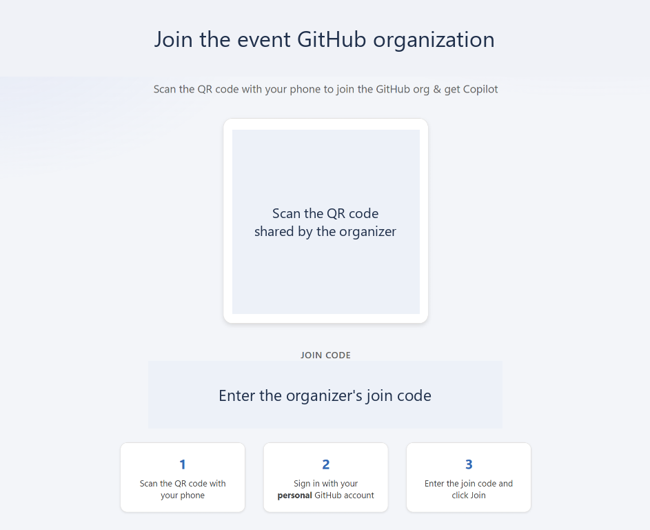
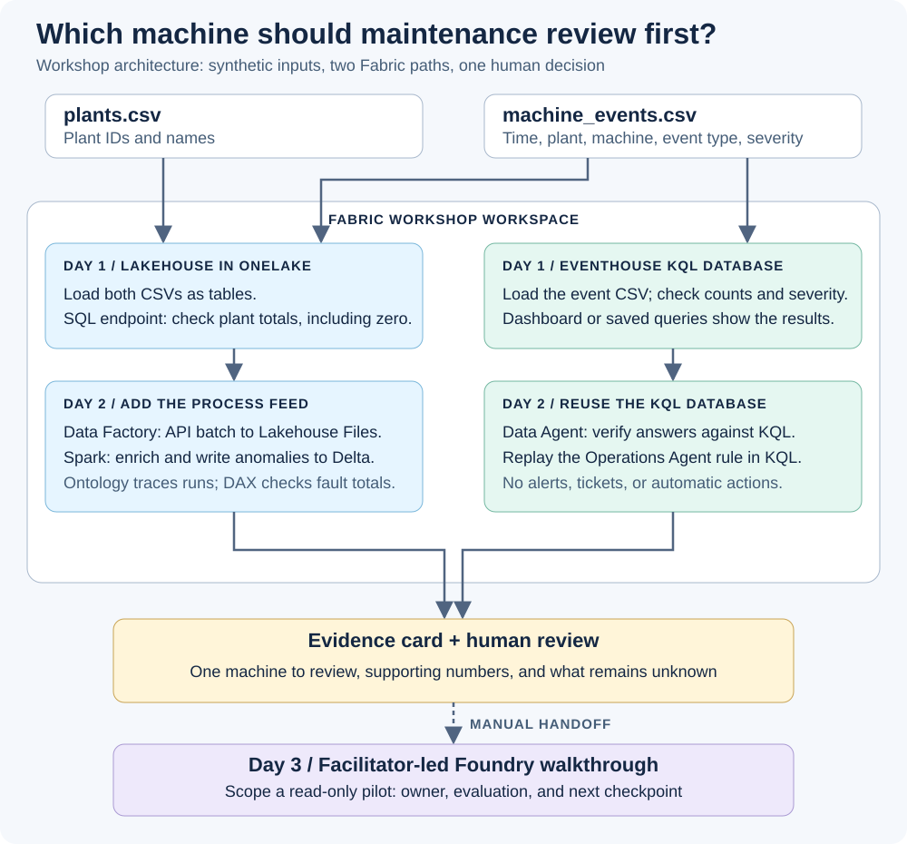

# Start here

**Bengaluru local time:** Monday and Tuesday 09:30–16:00; Wednesday 09:30–14:00.

## Prerequisites and downloads

Complete these checks on the laptop you'll use for the workshop. Fabric and GitHub are separate sign-ins.

### 1. Check your Fabric access

1. Bring your laptop and charger. Open [Microsoft Fabric](https://app.fabric.microsoft.com/) in Edge or Chrome and sign in with the **work or school account that was granted Fabric access**. Use the organizer's tenant and workspace link. Check Teams separately if your group is using it.
2. In the workshop workspace, open **New item**. Check that **Lakehouse** and **Eventhouse** are available. You don't need to create test items before class. To build, you need permission to create and edit items in a workspace on active Fabric capacity.
3. If the workspace is missing, check that you're using the invited account and the right tenant. If you can view but not create items, follow along with someone who has edit access or use the facilitator's prepared results. Use the lab's fallback if a feature such as model editing, Data Agent, ontology, or Operations Agent is unavailable.
4. Keep the same workspace and item names on Day 2. No VS Code, Power BI Desktop, or report authoring is required for the Fabric labs. Day 3 is facilitator-led; participants don't need a Foundry account or Azure subscription.

**No teams required.** Work on your own, or pair up if helpful. Replace `<LabID>` with your lab ID, without the angle brackets. For example, `MaintenanceLH_<LabID>` becomes `MaintenanceLH_lab07`. Choose your own short lab ID using lowercase letters and numbers, and make sure no one else in your workspace is using it. Keep the same ID on Day 2. Don't rename the core tables `plants` and `machine_events`.

### 2. Download and check the workshop data

1. Create a folder you can find easily, such as `Downloads\FabricWorkshop`.
2. Save both files below into that folder. If a link opens as plain text, use **Save As** (`Ctrl+S`) or right-click the link and choose **Save link as**. Keep the exact `.csv` filenames, not `.csv.txt` or `.xlsx`.

   | Download | What it contains | Where you'll use it |
   |---|---|---|
   | [plants.csv](https://raw.githubusercontent.com/kirannn-kp/fabric-manufacturing-workshop-site/main/data/plants.csv) | 3 plant records; look for `PlantId` and `PlantName` | Day 1 Lakehouse |
   | [machine_events.csv](https://raw.githubusercontent.com/kirannn-kp/fabric-manufacturing-workshop-site/main/data/machine_events.csv) | 500 event records; look for `EventTime`, `PlantId`, `MachineId`, `EventType`, and `Severity` | Day 1 Lakehouse **and** Eventhouse |

3. Open each file in a plain-text editor to confirm the first line contains comma-separated column names, not an HTML page. Close without editing. The counts above exclude the header row.
4. Wait for the Day 1 lab to upload the files. They contain synthetic data; you don't need to clean them, connect to SAP, or bring real plant data.

### Get GitHub Copilot access

The screenshot shows the event join page. Get the **scannable QR code and active join code** from the organizer at the event or in the private attendee channel; the public screenshot masks them.



1. **Choose your GitHub account.** The event join page asks for a **personal GitHub account**. If you want to use a **Bosch-managed GitHub account**, use it only if the organizer confirms it is supported for this event. Your Bosch work email or Fabric sign-in alone is not a GitHub account. If a different GitHub account is already signed in, switch accounts before joining.
2. **Open the join page.** Scan the organizer's QR code with your phone. If you can't scan it, ask for the private join link and open it on your laptop.
3. **Sign in and join.** Sign in to GitHub with the account you chose, enter the organizer's current join code, and select **Join**. If GitHub sends an organization invitation, accept it using the **same GitHub account**.
4. **Check Copilot access.** On your laptop, sign in to GitHub with that same account and open [GitHub Copilot settings](https://github.com/settings/copilot). If the event access doesn't appear, send the organizer your **GitHub username** privately so they can check the invitation and seat assignment. Don't share a password or verification code.

**Ready to start?** Have both CSVs and confirm you can create Fabric items. If something is blocked, tell the facilitator privately which step failed and the exact error. Use the prepared Fabric item or evidence card if needed. You can start the Fabric labs while Copilot access is pending.

---

# What we're solving — problem and architecture

You're the incoming shift lead. Two machines have repeated faults, and maintenance has time to review only one first. **Which machine should maintenance review first, and what evidence supports your choice?** A count tells you how often a machine reported a fault. It doesn't tell you how severe those faults were, what caused them, or whether a production order was affected.

You'll check the same incident from two Fabric paths, compare the results, and hand over **one recommendation someone else can reproduce**. Use the synthetic data only. Nothing in the workshop will start repairs, send alerts, or change a production system.

## Solution architecture



| Component | What it does in this workshop | What you keep |
|---|---|---|
| Two CSV inputs | `plants.csv` names the three plants. `machine_events.csv` records when each machine reported an event, its event type, and its severity. `PlantId` connects the files. | The original files, unchanged. |
| Lakehouse in OneLake | Load both CSVs and use SQL to check plant totals. On Day 2, land a separate synthetic API batch in Files, enrich it with Spark, and publish recipe anomalies as Delta tables. | Day 1 tables plus separate process and anomaly tables. |
| Eventhouse and Real-Time Dashboard | Load the event file into a KQL database. Count faults per plant and machine, and list the High-severity events separately. The dashboard or saved queries show both results. | Two views of the same incident: fault counts and event details. |
| Semantic model and Fabric IQ ontology | Check the Day 1 counts with DAX. Use an ontology to trace a Day 2 anomaly from its plant and machine to the specific process run. | Checked fault totals and a linked anomaly, or the same trace as a design exercise if ontology creation is unavailable. |
| Data Agent and Operations Agent rule | The draft Data Agent uses the **KQL database**, not the semantic model. Verify its answers against queries. Replay the Operations Agent rule in KQL against historical data; leave the agent stopped. | Checked answers and the results of the threshold test. |
| Evidence card and human review | A shift lead reads the supporting query results, chooses one machine for review, and notes what the data cannot prove. | One recommendation with the UTC window, counts, and a representative event. |
| Foundry and pilot planning | Bring the evidence card to the facilitator walkthrough. Discuss whether a read-only assistant would help with the next shift handoff and how to test it. | A one-page pilot scope with an owner, success checks, and a review date. |

The Day 1 event file is loaded twice on purpose: the Lakehouse copy supports SQL and the semantic model; the Eventhouse copy supports KQL, the dashboard, and the agent exercises. The separate Day 2 API batch lands only in the Lakehouse. **There is no automatic sync to Eventhouse or required live Foundry connection.** Day 3 gets the evidence card, not access to your Fabric workspace.

## How you'll reach a decision

1. **Check the inputs.** Confirm three plant records and 500 machine events. In the Lakehouse, use `PlantId` to match events to plants. Keep plants with zero faults in the result so “no faults” doesn't look like “missing plant.”
2. **Compare the same time window.** Use November 1–10, 2026 UTC (include November 1, exclude November 11). In Eventhouse, count `Fault` events by `PlantId` and `MachineId`. Start by flagging machines with at least three faults. Split the window into two five-day periods to see whether the pattern changes.
3. **Break a tie with severity, not guesswork.** List `High` events for the whole window, separately from the fault count. If two machines tie on counts, compare their High events and record a timestamp another reader can look up. High severity helps set priority; it isn't a root-cause diagnosis.
4. **Cross-check before recommending.** Verify the fault scorecard with KQL and DAX. In a separate pipeline, detect an unexpected recipe change and trace it with the ontology. Check the Data Agent's answer against KQL and replay the Operations Agent rule. Treat the anomaly as additional context, not proof that it caused any fault.
5. **Handoff and scope the pilot.** Fill in: “Review ___ first. In ___ UTC, it recorded ___ faults and ___ High events; one example is ___. The data does not tell us ___.” On Day 3, turn this into a read-only pilot for one plant and one shift. Include a positive case and a case where the assistant should say it doesn't know.

**Before you move on:** Check that you can explain which file goes into each Fabric item, how you'd break a tie, and what the final recommendation must not claim. Use the **Evidence card and help** page to check your work after the labs.

---

# Day 1 — Build the data assets in Fabric

**09:30–11:30 is facilitator-led:** theory, discussion, a 15-minute break, and a demo. **Hands-on work starts at 11:30.**

| Time | Activity | What you leave with |
|---|---|---|
| 09:30–10:00 | Welcome and the maintenance problem | A shared decision and list of evidence needed |
| 10:00–10:45 | Fabric concepts: workspace, OneLake, Lakehouse, and Eventhouse | A map of where files, tables, and telemetry live |
| 10:45–11:00 | Break | |
| 11:00–11:30 | Facilitator demo: from file to table and query | A working example to follow |
| 11:30–12:30 | Lakehouse build and SQL validation | Two queryable tables and a plant-level quality check |
| 12:30–13:15 | Lunch | |
| 13:15–14:30 | Eventhouse build and guided KQL | One KQL database and three verified results |
| 14:30–14:45 | Break | |
| 14:45–15:35 | Independent investigation and Real-Time Dashboard | A maintenance dashboard or saved query results |
| 15:35–16:00 | Show what you built and save the Day 2 handoff | Workspace/item names and reproducible evidence |

## 09:30–11:30 — Understand the flow before building

- **Read alongside the demo:** [What is Microsoft Fabric?](https://learn.microsoft.com/en-us/fabric/fundamentals/microsoft-fabric-overview) and [What is OneLake?](https://learn.microsoft.com/en-us/fabric/onelake/onelake-overview)
- **Frame the decision:** Ask what a shift lead needs to know before recommending a maintenance review. Agree that repeated faults and High severity are evidence for priority, not proof of root cause.
- **Explain the Fabric items:** A workspace holds the items; OneLake stores the Lakehouse data; the Lakehouse makes files queryable as tables; the Eventhouse KQL database is the event-analysis copy. Briefly show where semantic models and agents fit tomorrow. No second scenario or tool setup is needed.
- **Demonstrate:** Show `plants.csv` as a file, then as a table. Show the separate KQL database and a row-count query. Explain why the same telemetry CSV is loaded twice: the Lakehouse copy feeds the semantic model, and the KQL copy feeds the agents.

## 11:30 — Build the Lakehouse

**What you'll do:** Turn two CSVs into tables and check fault totals by plant. **Microsoft Learn:** [Lakehouse overview](https://learn.microsoft.com/en-us/fabric/data-engineering/lakehouse-overview), [Load files to tables](https://learn.microsoft.com/en-us/fabric/data-engineering/load-to-tables), and [Use the SQL analytics endpoint](https://learn.microsoft.com/en-us/fabric/data-engineering/lakehouse-sql-analytics-endpoint).

1. **Guided (15 min):** Choose **New item > Lakehouse**, name it `MaintenanceLH_<LabID>` (for example, `MaintenanceLH_lab07`), and keep Lakehouse schemas enabled. Use the lab ID you chose in place of `lab07`. In **Files**, upload `plants.csv`. From the file's **More options**, select **Load to Tables > New table**. Keep `dbo`, name it `plants`, and keep the comma separator and header option enabled. Open **Tables > dbo > plants**. Check `P01`, `P02`, and `P03`.
2. **Build independently (20 min):** Repeat with `machine_events.csv`, naming the table `machine_events`. Identify `EventTime`, `PlantId`, `MachineId`, `EventType`, and `Severity`. Make sure both tables appear under **Tables**, not only **Files**. If an import is pending or throttled, don't repeatedly upload it; use the prepared Lakehouse.
3. **Validate in SQL (25 min):** Switch the Lakehouse to its **SQL analytics endpoint**, open **New SQL query**, and run the query below. The endpoint lets you query the same tables without copying them or changing the source data. Predict whether Plant East will appear before running. Then change `LEFT JOIN` to `INNER JOIN` and note what changed and why.

   ```sql
   SELECT p.PlantId, p.PlantName, COUNT(e.PlantId) AS FaultCount
   FROM dbo.plants AS p
   LEFT JOIN dbo.machine_events AS e
       ON e.PlantId = p.PlantId
       AND e.EventType = 'Fault'
       AND e.EventTime >= '2026-11-01T00:00:00'
       AND e.EventTime <  '2026-11-11T00:00:00'
   GROUP BY p.PlantId, p.PlantName
   ORDER BY p.PlantId;
   ```

   **Check:** North 8, South 8, East 0. The inner join drops East. If tables are still syncing or the SQL endpoint is unavailable, use the prepared endpoint or group the CSV and retain all three plants from the lookup.

   **Fast finish:** Reverse the join: start from `machine_events`, left join `plants` on `PlantId`, and count rows where `p.PlantId IS NULL`. Expect zero unmatched events. Explain how an unmatched event could affect a plant filter in tomorrow's model.

## 13:15 — Build and query Eventhouse

**What you'll do:** Load the event file into a KQL database to compare machines within one time window. **Microsoft Learn:** [What is an Eventhouse?](https://learn.microsoft.com/en-us/fabric/real-time-intelligence/eventhouse), [Ingest a local file](https://learn.microsoft.com/en-us/fabric/real-time-intelligence/get-data-local-file), and [KQL reference](https://learn.microsoft.com/en-us/kusto/query/?view=microsoft-fabric).

1. **Set up (25 min):** Choose **New item > Eventhouse** and name it `MaintenanceEvents_<LabID>` (for example, `MaintenanceEvents_lab07`). Use the lab ID you chose in place of `lab07`. Open its KQL database and select **Get data > Local file > New table**. Upload `machine_events.csv`, name the table `machine_events`, choose CSV with **First row header**, and confirm `EventTime` is datetime. Finish and wait. If using a prepared KQL database, skip the upload. Do not ingest twice.
2. **Query (35 min):** Open **Query > Query with code**. If you save a KQL queryset, name it `MaintenanceQueries_<LabID>` (for example, `MaintenanceQueries_lab07`). Use the lab ID you chose in place of `lab07`. Paste one block per tab and select **Run**. Write down the UTC window, filters, and each result.

   ```kusto
   machine_events
   | count
   ```

   ```kusto
   machine_events
   | where EventTime >= datetime(2026-11-01) and EventTime < datetime(2026-11-11)
   | where EventType == "Fault"
   | summarize FaultCount = count() by PlantId, MachineId
   | where FaultCount >= 3
   | order by FaultCount desc, MachineId asc
   ```

   ```kusto
   machine_events
   | where EventTime >= datetime(2026-11-01) and EventTime < datetime(2026-11-11)
   | where Severity == "High"
   | project EventTime, PlantId, MachineId, EventType
   | order by EventTime asc
   ```

3. **Check (15 min):** Expect 500 rows; 8 faults per qualifying machine; and 6 High events, all on `MC-N01`. The severity query does not filter on `EventType`. If KQL is unavailable, filter the CSV or use the evidence card and explain how the results would be reproduced.

## 14:45 — Investigate, build a dashboard, and hand off

**Microsoft Learn:** [Create a Real-Time Dashboard from a KQL query](https://learn.microsoft.com/en-us/fabric/real-time-intelligence/dashboard-real-time-create).

- **Independent investigation (20 min):** Copy the repeated-fault query into two new tabs. Change the first window to November 1–5 inclusive (`< datetime(2026-11-06)`) and the second to November 6–10 inclusive (`>= datetime(2026-11-06)`). Predict the results, then verify both machines go from five to three faults.
- **Build a Real-Time Dashboard (30 min):** In a KQL queryset connected to your Day 1 database, run the original repeated-fault query and choose **Save to dashboard > To a new Dashboard**. Name it `MaintenanceReview_<LabID>` (for example, `MaintenanceReview_lab07`). Use the lab ID you chose in place of `lab07`. Run the High-severity query in another tab and save it to that dashboard as a second tile. Name the tiles **Repeated faults** and **High-severity events**. Verify two groups in the first tile and six events in the second. This is a Fabric Real-Time Dashboard, not a Power BI report or a live feed. If dashboard creation is unavailable, keep the two results in named query tabs or private notes.
- **Handoff (25 min):** Use only your dashboard or query results to recommend a machine, explain the evidence, and name one thing the records cannot prove. If working with someone, have them check your reasoning. Record the workspace and item names, the two results, one representative event, and the recommendation. Reopen these assets tomorrow.

**Day 1 checkpoint:** Show both Lakehouse tables, the 500-row KQL check, and the two incident results in the dashboard or saved queries. Record enough detail for someone else to reproduce your results.

## Optional Day 1 lab — Make ingestion repeatable (30–45 min)

Do this after the core handoff is ready. Use the same synthetic CSV already in your Day 1 Lakehouse; no external connector is needed.

1. Create a **Pipeline** (also called **Data pipeline**) named `MaintenanceLoad_<LabID>` (for example, `MaintenanceLoad_lab07`). Use the lab ID you chose in place of `lab07`. On the ribbon, choose **Copy data > Add copy data activity**. In **Source**, use **Connection > Browse all > OneLake catalog** to select your Day 1 Lakehouse. Choose **Files**, then browse to `machine_events.csv`. Choose **DelimitedText**, comma delimiter, and **First row as header**. Preview the source and confirm columns such as `EventTime` and `MachineId` are separate.
2. In **Destination**, use **Connection > Browse all > OneLake catalog** to select the same Lakehouse. Choose **Tables > New** and use a new practice table named `machine_events_pipeline_<LabID>` (for example, `machine_events_pipeline_lab07`). Use the lab ID you chose in place of `lab07`. Choose **Overwrite** as the table action. Verify the target isn't the core `machine_events` table. Check the column mapping before running.
3. Save and run manually. Open the activity output or run history and verify the run succeeded and copied **500 rows**. In the Lakehouse SQL analytics endpoint, check `COUNT(*)` in the practice table after it appears. Run the pipeline a second time and confirm the table still has **500**, not **1,000**. Record both run results and explain why **Append** would behave differently.
4. Leave the pipeline unscheduled. If creation, connection, or table creation is blocked, keep the manual Lakehouse import as the core path and review a facilitator run rather than retrying on the shared core tables.

[Microsoft Learn: Configure a Lakehouse Copy activity](https://learn.microsoft.com/en-us/fabric/data-factory/connector-lakehouse-copy-activity)

---

# Day 2 — Use the same assets to build in Fabric

**09:30–11:30 is facilitator-led:** recap, theory, a 15-minute break, and a demo using Day 1's assets. **Hands-on work starts at 11:30.**

**Intermediate challenge: defend your maintenance recommendation.** Two machines tie on fault count. Use the prepared KQL scorecard in the 13:15 lab to verify the Day 1 fault evidence; you didn't need to build a scorecard yesterday. In today's hands-on lab, use a separate process feed to detect an unexpected recipe change. Connect the Copy and Notebook activities and trace the result in Fabric IQ. The process feed adds context; it doesn't prove what caused a fault.

| Time | Activity | What you leave with |
|---|---|---|
| 09:30–10:00 | Facilitator recap: trace the Day 1 evidence | A shared view of the two data paths and the maintenance decision |
| 10:00–10:45 | Theory: Data Factory, Spark and OneLake, semantic models, ontology, and agents | A map of which tool produces, checks, or explains the evidence |
| 10:45–11:00 | Break | |
| 11:00–11:30 | Facilitator demo: preview the API pipeline, prepared scorecard, and ontology | One worked example without solving the anomaly exercise |
| 11:30–12:30 | Pull a synthetic API batch, enrich it, and automate the anomaly check | Two process-run outcomes, one anomaly, and a repeatable pipeline design |
| 12:30–13:15 | Lunch | |
| 13:15–13:55 | Use the semantic model to cross-check the scorecard | An independently checked fault total and a filter prediction |
| 13:55–14:40 | Test a draft Data Agent with precise and misleading questions | A corrected prompt and a pass/partial/fail evaluation |
| 14:40–14:55 | Break | |
| 14:55–15:30 | Build and trace an ontology in Fabric IQ | Plant, machine, process run, and anomaly linked by keys |
| 15:30–15:45 | Replay an Operations Agent rule and defend a threshold | A recorded threshold trade-off, with no actions running |
| 15:45–16:00 | Present your recommendation and discuss the platform comparison | One evidence card for Day 3 and one question for a fair pilot |

## 09:30–11:30 — Preview the pipeline, model, ontology, and agents

- **Recap (30 min):** The facilitator opens the Day 1 Lakehouse, KQL database, and dashboard or saved queries. Ask the room what broke the tie in fault counts and what the data still cannot prove.
- **Theory (45 min):** Data Factory lands an API response; Spark applies a custom rule and writes results to OneLake. DAX and KQL check the separate Day 1 fault evidence. An ontology links business entities so reviewers can follow the evidence. Both agent exercises still use Day 1 KQL, not the notebook output or the semantic model.
- **Demo (30 min, after the break):** Preview the Copy → Notebook success dependency, cross-check one Day 1 result with DAX or KQL, and demonstrate one already configured ontology relationship if available. Use a normal run for the demo so participants can work out the day-5 result themselves.

## 11:30 — Automate API ingestion and detect an unexpected recipe

**Starter files:** [Synthetic process batch](https://raw.githubusercontent.com/kirannn-kp/fabric-manufacturing-workshop-site/main/data/process_batch.json) · [Importable Spark SQL notebook](https://raw.githubusercontent.com/kirannn-kp/fabric-manufacturing-workshop-site/main/labs/process-anomaly.ipynb). Save both files locally with their original extensions. The source is a fixed replay of November 1–5, 2026 UTC, not a live plant feed.

**Start here — all participants**

1. Reopen your **Day 1 workspace and Lakehouse**. Confirm it contains the `plants` table. Keep the same lab ID you chose on Day 1; `lab07` is only an example.
2. Start with the **workshop API**. The Copy activity and notebook must use the **same Lakehouse** and file: `Files/process_lab07/process_batch.json`, with `lab07` replaced by your lab ID.
3. If you can't copy the file within **10 minutes**, switch to the JSON upload below and continue with the notebook. You don't need a working pipeline to do the notebook or ontology lab.

**Microsoft Learn:** [HTTP in a Copy activity](https://learn.microsoft.com/en-us/fabric/data-factory/connector-http-copy-activity) · [Lakehouse destination](https://learn.microsoft.com/en-us/fabric/data-factory/connector-lakehouse-copy-activity) · [Notebook activity](https://learn.microsoft.com/en-us/fabric/data-factory/notebook-activity) · [Pipeline runs and schedules](https://learn.microsoft.com/en-us/fabric/data-factory/pipeline-runs).

### 1. Land the batch (10 min)

**Participant action:** Create a **Data pipeline** named `MaintenanceProcessPipeline_<LabID>` and add a **Copy data** activity. Use the facilitator's pipeline as a reference, not as your destination. Watching the demo does not put the file in your folder.

| Copy setting | Value |
|---|---|
| Source | **HTTP** connection, **Anonymous** authentication, `GET` |
| Base URL | `https://api.github.com` |
| Relative URL | `repos/kirannn-kp/fabric-manufacturing-workshop-site/contents/data/process_batch.json?ref=main` |
| Additional headers | `User-Agent`: `Fabric-Workshop`; `Accept`: `application/vnd.github+json` |
| Source file format | **Binary** (keep the response unchanged) |
| Destination | Your **Day 1 Lakehouse** → **Files** → **Binary** format |
| Folder and file | Folder `process_lab07` (replace `lab07` with your lab ID); file `process_batch.json` |

Save and **Run** the pipeline manually. In your Lakehouse, expand **Files**, open your `process_<LabID>` folder, and confirm `process_batch.json` is there before moving on.

**Fallback — upload instead:** In that Lakehouse, open **Files**, create `process_<LabID>` if needed, and upload the downloaded `process_batch.json` into it. Check the file name and folder match the notebook path. The notebook reads both the API response and the downloaded JSON. Note that you used an upload, then go straight to step 2.

### 2. Set up the notebook and write the rule (25 min)

1. In the workspace, select **Import → Notebook** and import the `.ipynb` starter as `MaintenanceProcessNotebook_<LabID>`.
2. Attach your **Day 1 Lakehouse** and make it the **default**. In the notebook, replace `lab07` with your lab ID in the input path and every output table name. If your Lakehouse doesn't use schemas, remove `dbo.` from the notebook's SQL.
3. Write your rule before you scroll to the reference SQL. Use the plant lookup, the expected recipe for each plant and machine, and the approval for each run. Decide how to handle four cases: matching recipe, change approved for that exact recipe, unexpected change, and missing required data. Then compare your rule with the starter.

### 3. Run the notebook and check the result (15 min)

Run the notebook cells in order. In the last two outputs, check for **8 Normal, 1 ApprovedChange, and 1 Anomaly**. The only anomaly should be `N01-D05` on `MC-N01` on **November 5 UTC** (expected `A`, actual `B`). `S01-D05` also switched to `B`, but it was approved and must not be flagged.

**Save for 14:55:** In the Lakehouse under **Tables** (under `dbo` if schemas are enabled), find your `process_machines_<LabID>`, `process_runs_<LabID>`, and `process_anomalies_<LabID>` Delta tables. You'll bind them in the ontology lab. A repeat run replaces only your three practice snapshots, so the anomaly count stays **1**. Don't overwrite `plants`, `machine_events`, or another participant's outputs.

**Fallback — notebook or Delta writes blocked:** After 10 minutes of troubleshooting, use the facilitator's tables if available. Otherwise work out the rule from the JSON and check it against **Evidence card and help**. Record which fallback you used.

### 4. Connect and check the pipeline (10 min)

- **Participant action, if Copy and the notebook both worked:** Add a **Notebook** activity, select your saved notebook, and connect Copy data → Notebook with **On success**. Save, **Run** manually, and check both activities in run history. If they're still running when time is up, record the run as pending.
- **Facilitator demo:** Show the **On success** dependency, a completed run if available, and where to set a daily schedule. If you used the JSON upload or notebook fallback, follow the demo or review the design instead of wiring a failing activity. Don't mark a demo or fallback as your own successful run.

**Leave scheduling off.** A production pipeline would pass a run date or watermark and merge by stable IDs instead of replacing a fixed snapshot. Don't enable alerts or write back to manufacturing systems.

**Optional — use your own API after the sample lab:** Early finishers can try a small, approved endpoint that already works from Fabric. Use a separate practice pipeline and destination. Adapt the connection and map the payload to the starter's `runs`, `recipePlans`, and `approvedChanges` fields before reusing the notebook. Keep the sample tables for the ontology exercise. Don't put credentials or internal data in GitHub or MOAW.

## 13:15 — Cross-check Day 1 faults in a semantic model

Open your Day 1 KQL queryset and run the **prepared scorecard query below**, or use the facilitator's saved output. It uses the Day 1 `machine_events` data, not the new process tables. The morning's process runs are not used to calculate Day 1 fault rates.

```kusto
machine_events
| where EventTime >= datetime(2026-11-01) and EventTime < datetime(2026-11-11)
| summarize TotalEvents = count(),
            Faults = countif(EventType == "Fault"),
            HighEvents = countif(Severity == "High") by PlantId, MachineId
| extend FaultRatePct = round(100.0 * Faults / TotalEvents, 2)
| order by Faults desc, HighEvents desc, PlantId asc, MachineId asc
```

**What you'll do:** Cross-check the fault totals from the Lakehouse copy, without building a report. **Microsoft Learn:** [Direct Lake overview](https://learn.microsoft.com/en-us/fabric/fundamentals/direct-lake-overview), [DAX query view](https://learn.microsoft.com/en-us/power-bi/transform-model/dax-query-view), and [Edit model relationships and measures](https://learn.microsoft.com/en-us/power-bi/transform-model/service-edit-data-models).

1. **Create or open (15 min):** In the Lakehouse choose **New semantic model** and name it `MaintenanceModel_<LabID>` (for example, `MaintenanceModel_lab07`). Use the lab ID you chose in place of `lab07`. Select only the existing `plants` and `machine_events` tables. If creation is blocked, open the prepared two-table model. No report is needed.
2. **Validate (15 min):** Open **DAX query view > New query**, paste the following, and select **Run**. It works in Viewing mode and does not change the model. Compare the returned fault counts with your scorecard. Explain why zero-fault machines can be absent from this DAX result but must still appear in the scorecard.

   ```dax
   EVALUATE
   SUMMARIZECOLUMNS(
       machine_events[PlantId], machine_events[MachineId],
       "Events",
       CALCULATE(
           COUNTROWS(machine_events),
           KEEPFILTERS(machine_events[EventType] = "Fault"),
           machine_events[EventTime] >= DATE(2026, 11, 1),
           machine_events[EventTime] < DATE(2026, 11, 11)
       )
   )
   ```

3. **Predict the filter result (10 min):** Draw `plants[PlantId]` (one) → `machine_events[PlantId]` (many). Predict how selecting Plant North should change the total. The read-only query above checks counts, not relationship propagation. If the model cannot open, filter the KQL results to `P01` and check against the plant lookup.

**Optional if time permits and editing has been verified:** Create the active single-direction relationship in **Manage relationships** and add a measure to `machine_events`: `Machine fault count = CALCULATE(COUNTROWS(machine_events), machine_events[EventType] = "Fault")`. In the same incident window, check 16 overall and 8 when filtered through `plants` to `P01`.

## 13:55 — Build and evaluate the Data Agent

**What you'll do:** Test a draft that answers questions from your KQL database. Treat query results as the reference, not the draft's wording. **Microsoft Learn:** [Create and test a Fabric Data Agent](https://learn.microsoft.com/en-us/fabric/data-science/how-to-create-data-agent).

1. **Connect (15 min):** Choose **New item > Data agent** and name it `MaintenanceDataAgent_<LabID>` (for example, `MaintenanceDataAgent_lab07`). Use the lab ID you chose in place of `lab07`. In the draft, choose **Add a data source**, select your Day 1 **KQL database**, not the Eventhouse container, and select **Add**. Under **Explorer > Sources > Tables**, check `machine_events`. Keep the agent a draft.
2. **Test (10 min):** In **Test the agent's responses**, paste Q1 and Q2 below one at a time. Record the answers before checking them against your scorecard.
3. **Challenge and retest (15 min):** Paste Q3 to test a question the data cannot answer. For Q4, write your own ranking prompt first. If the answer is off, tighten the window, filters, tie-break rule, or requested columns and rerun it. Use the sample prompt if stuck. Record what changed.
4. **Score (5 min):** Mark each answer **pass** if the facts match KQL and it respects what the data can show, **partial** if it omits requested evidence, or **fail** if it gives wrong numbers or invents impact. If the agent is unavailable, answer the same questions from saved KQL results and label your work as a fallback.

**Copy-paste Data Agent questions:** Each prompt includes its own time window, so it can be run on its own.

| Test | Prompt to paste |
|---|---|
| Q1 · Count faults | `From 2026-11-01 00:00 UTC (inclusive) to 2026-11-11 00:00 UTC (exclusive), which plant and machine pairs had at least three events where EventType is Fault? Return PlantId, MachineId, and the exact fault count.` |
| Q2 · Check severity | `From 2026-11-01 00:00 UTC (inclusive) to 2026-11-11 00:00 UTC (exclusive), count events where Severity is High, regardless of EventType. Return PlantId, MachineId, and the High event count for each pair with at least one High event.` |
| Q3 · Test the evidence boundary | `From 2026-11-01 00:00 UTC (inclusive) to 2026-11-11 00:00 UTC (exclusive), which production orders were affected by the machine faults? Use only the connected data. If it cannot establish which orders were affected, tell me what evidence is missing.` |
| Q4 · Rank and explain (sample after your own attempt) | `From 2026-11-01 00:00 UTC (inclusive) to 2026-11-11 00:00 UTC (exclusive), keep plant and machine pairs with at least three Fault events. Rank them by fault count, highest first, breaking ties by the count of High events regardless of event type. Return PlantId, MachineId, fault count, all recorded events, fault percentage, and High event count. Recommend one machine for human review and explain what the fault percentage does not tell us.` |
| Q5 · Find the first High event (optional) | `From 2026-11-01 00:00 UTC (inclusive) to 2026-11-11 00:00 UTC (exclusive), find the earliest event where Severity is High, regardless of EventType. Return PlantId, MachineId, and the UTC timestamp.` |
| Q6 · Check an empty result (optional) | `From 2026-11-01 00:00 UTC (inclusive) to 2026-11-11 00:00 UTC (exclusive), did any plant and machine pair have at least nine events where EventType is Fault? If none qualify, say so.` |

**Check against KQL after you run the prompts:**

| Test | Expected result |
|---|---|
| Q1 | `P01 / MC-N01` and `P02 / MC-S01` each had **8** faults. |
| Q2 | **6** High events, all on `P01 / MC-N01`. |
| Q3 | The connected data cannot establish order impact. It has no link from a machine and event time to a production order, and a time match alone would not prove impact. |
| Q4 | Review **`MC-N01`** first: both machines had 8 faults out of 8 recorded events (100%), but it had **6** High events versus **0** on `MC-S01`. The percentage is not a failure probability or a measure of operating time. |
| Q5 | `P01 / MC-N01`, **2026-11-01 00:00 UTC**. |
| Q6 | No machine met the cutoff. |

**Fast finish:** Compare fault counts with fault rates by plant using the same window. In KQL, summarize `TotalEvents = count(), Faults = countif(EventType == "Fault") by PlantId`, then calculate `FaultRatePct = round(100.0 * Faults / TotalEvents, 2)` with `extend`. Explain why a fault rate does not replace the severity evidence. If the dashboard is available, add the result as a third tile.

## 14:55 — Create a Fabric IQ ontology and trace the anomaly

**Start with your Lakehouse tables, not KQL.** You'll use `plants` from Day 1 and the three `process_*_<LabID>` tables from the 11:30 notebook. If your notebook didn't produce them, use the facilitator's tables if available. If you can't create an ontology or read the tables, take the design fallback below.

**Microsoft Learn:** [Create an ontology](https://learn.microsoft.com/en-us/fabric/iq/ontology/tutorial-1-create-ontology) · [Create and bind relationship types](https://learn.microsoft.com/en-us/fabric/iq/ontology/how-to-create-relationship-types).

1. **Create (5 min):** In the workshop workspace, select **New item → Ontology (preview)** and name it `MaintenanceOntology_<LabID>` using your lab ID. If the item is missing or creation is blocked, don't change tenant settings; use the design fallback.
2. **First live checkpoint (15 min):** Bind `Plant` and `Machine` to their tables using the first two rows below. Set their unique keys and add `ContainsMachine` using `PlantId` on both sides. Save and check that `P01` links to `P01:MC-N01`.
3. **Complete the trace (15 min):** Bind `ProcessRun` and `Anomaly` and add `ExecutesRun` and `HasAnomaly`. For all three relationships, leave **Use mapping table** off: the matching columns are already in both tables. Save and open **Explore ontology**. Check both paths below. If time runs out or instances are still loading, keep your first checkpoint and trace the remaining links using the tables or evidence card.

| Entity type | OneLake table | Unique entity key | Other properties to bind |
|---|---|---|---|
| `Plant` | `plants` | `PlantId` | `PlantName` |
| `Machine` | `process_machines_<LabID>` | `MachineKey` | `PlantId`, `MachineId`, `LineName` |
| `ProcessRun` | `process_runs_<LabID>` | `RunId` | `MachineKey`, `RunDateUtc`, `RunStatus` |
| `Anomaly` | `process_anomalies_<LabID>` | `AnomalyId` | `RunId`, `ExpectedRecipe`, `ActualRecipe`, `Reason` |

| Relationship | Origin → target | Matching properties |
|---|---|---|
| `ContainsMachine` | Plant → Machine | `PlantId` → `PlantId` |
| `ExecutesRun` | Machine → ProcessRun | `MachineKey` → `MachineKey` |
| `HasAnomaly` | ProcessRun → Anomaly | `RunId` → `RunId` |

**Check both paths:**

- **Flagged:** `P01` → `P01:MC-N01` → `N01-D05` → `N01-D05:recipe_mismatch`. Check the expected recipe `A`, actual `B`, and the reason.
- **Approved:** `P02` → `P02:MC-S01` → `S01-D05`. The run should be `ApprovedChange`, with no linked anomaly.

**Design fallback:** Use **Evidence card and help** or the facilitator's tables to draw the same four entities, label the arrows with their matching properties, and trace both paths. Record what you completed live and what you checked on paper. In either path, explain why linking a run to a production order would require an approved run-to-order mapping, and why sharing a machine ID does not establish a causal link to the Day 1 faults.

## 15:30 — Replay an Operations Agent rule

**Microsoft Learn:** [Operations Agent and playbooks](https://learn.microsoft.com/en-us/fabric/real-time-intelligence/operations-agent). Read about rules and playbooks; skip instructions to start the agent or configure actions.

1. **Inspect (5 min):** Open the facilitator's stopped playbook. Identify the data source, grouping, threshold, and intended human action. If unavailable, annotate those parts in your notes. Do not start the agent or configure any actions.
2. **Replay and decide (10 min):** Use the Day 1 KQL query at `>= 3`, `>= 8`, and `>= 9`; use saved results if needed. Use the checks below to explain why severity breaks the tie. Record the notebook's recipe anomaly as a separate signal and leave the decision with a human.

**Operations Agent rule-check questions:** These are for the group to answer from the stopped playbook and historical KQL, not prompts to paste into the Data Agent.

| Check | Question | Expected evidence |
|---|---|---|
| Shortlist | Which plant and machine pairs qualify at each cutoff: 3+, 8+, and 9+ faults? | `P01 / MC-N01` and `P02 / MC-S01` qualify at 3+ and 8+; neither qualifies at 9+. |
| Trade-off | Why can't you just raise the cutoff to choose one of the two machines? | They both had 8 faults, so raising the cutoff keeps both or drops both. |
| Priority | Keep the 3+ shortlist. Which machine comes first when you break ties using High events, and what should happen next? | `MC-N01`: 6 High events versus 0 on `MC-S01`. Recommend human review only; don't trigger an action. |

## 15:45 — Present the evidence and compare platforms

- **Evidence (10 min):** Show the fault and severity counts, one checked agent answer, and the traced recipe anomaly. State one limitation: the two sources don't prove causation or order impact. Label any fallback and carry the evidence card into Day 3.
- **Fabric vs. Databricks (5 min):** Record how you landed the API batch, tested and reran the notebook, and made a flagged run traceable for a reviewer. Use the same inputs, rule, and expected results in an Azure Databricks pilot. Compare effort, monitoring, and governance. This workshop is not a performance or pricing benchmark.

[Microsoft Learn: Fabric end-to-end tutorials](https://learn.microsoft.com/en-us/fabric/fundamentals/end-to-end-tutorials) · [Microsoft Learn: What is Azure Databricks?](https://learn.microsoft.com/en-us/azure/databricks/introduction/)

## Optional Day 2 lab — Add a dashboard plant selector (20–30 min)

Use the Day 1 Real-Time Dashboard you built, not a shared facilitator item. Keep the historical UTC window in both tile queries.

1. In **Editing**, choose **Add parameter** and add a visible **Single selection** parameter. Set **Label** to `Plant`, **Variable name** to `_plant`, **Data type** to **String**, and **Source** to **Fixed values**. Add `All`, `P01`, and `P02`, with `All` as the default. Use the literal `All` choice rather than a generated **Select all** option. Select **Done**.
2. For each tile, choose **Tile actions > Edit**. If the menu is hard to click, focus **Tile actions** and press Enter. In the query, insert the following after the date filter and before `summarize` or `project`. Select **Run** and check the result before selecting **Apply**. Then **Save** on the dashboard and confirm **Save changes** if prompted.

   ```kusto
   | where _plant == "All" or PlantId == _plant
   ```

3. Reopen the dashboard and check the three choices: **P01** shows **8 faults and 6 High events**; **P02** shows **8 faults and no High rows**; **All** restores **two fault groups and six High rows**. Explain why the High tile is empty for P02 even though that plant has faults.
4. If dashboard editing or saving is unavailable, run the same checks in KQL tabs using `| where PlantId == "P01"` or `| where PlantId == "P02"` before aggregation or projection. For All, remove the plant filter.

[Microsoft Learn: Use parameters in Real-Time Dashboard queries](https://learn.microsoft.com/en-us/fabric/real-time-intelligence/dashboard-parameters)

If you finish early on either Fabric day, you can also pick one exercise from **Optional Fabric reserve labs** at the end of this guide.

---

# Day 3 — Foundry walkthrough and PoC, finish at 14:00

| Time | Activity | What you leave with |
|---|---|---|
| 09:30–10:00 | Recap the Fabric investigation | The decision and its evidence |
| 10:00–11:00 | Facilitator-led Foundry overview and example | A clear idea of what Foundry adds and when it isn't needed |
| 11:00–11:15 | Break | |
| 11:15–12:15 | Scope one proof of concept | Draft pilot with boundaries and success checks |
| 12:15–13:00 | Lunch | |
| 13:00–13:40 | Review the scope and identify blockers | Dependencies, owners, and approval gates |
| 13:40–14:00 | Agree next steps and close | A dated checkpoint and action list |

## Foundry overview (no participant setup)

**Microsoft Learn:** [What is Microsoft Foundry?](https://learn.microsoft.com/en-us/azure/foundry/what-is-foundry), [Foundry Agent Service overview](https://learn.microsoft.com/en-us/azure/foundry/agents/overview), and [Evaluate a generative AI application](https://learn.microsoft.com/en-us/azure/foundry/how-to/evaluate-generative-ai-app). These are for reading, not participant setup.

Use about 20 minutes for the model, agent instructions, read-only tools, and evaluation; 20 minutes to show how an assistant might answer the Day 2 maintenance question using Fabric evidence; and 20 minutes to discuss when the existing Fabric Data Agent is enough. If the facilitator has an already working environment, show it. Otherwise use a diagram and the Day 2 answers. On both paths, compare an evidence-backed response with one that incorrectly claims a root cause. Don't publish team drafts or provision a project during the workshop.

## One-page PoC

| Decide | Write down |
|---|---|
| Problem and scope | One plant, one shift handoff, and one maintenance decision. What is out of scope? |
| User and owner | Who reviews the evidence, who owns the pilot, and who approves any action? |
| Data and access | What approved fields are needed, who owns them, and what mapping is missing? |
| Success | Replay ten labeled windows with positive and negative cases. Agree acceptable false alarms and missed cases **before** running the pilot. |
| Boundaries | Read-only recommendations. No automatic messages, tickets, or maintenance actions. |
| Next step | One blocker, one owner, one due date, and a review checkpoint. |

Draft privately for 30 minutes, exchange plans for 20 minutes, then revise for 10 minutes. After lunch, check the data and approval dependencies against the scope. Close by reading back the owner, next action, and date. No production deployment is part of the workshop.

**Day 3 checkpoint:** Hand over a one-page scope that names the decision, data owner, human reviewer, one positive and one negative evaluation case, and the next review date.

---

# Evidence card and help

| Check | Reference result |
|---|---|
| Lakehouse inputs | Three plants; `P01` is Plant North, `P02` Plant South, `P03` Plant East. |
| KQL sample | 500 events: 484 Run and 16 Fault. |
| SQL validation | Plant North 8, Plant South 8, Plant East 0; zero unmatched event plant IDs. |
| Fault-rate extension | North 8/169 (4.73%); South 8/170 (4.71%); East 0/161 (0%). |
| November 1–10 UTC | `P01 / MC-N01`: 8 faults; `P02 / MC-S01`: 8 faults. |
| Day 2 machine scorecard | Five machine rows, 500 events, and 16 faults in total. `MC-N01` and `MC-S01` each show 8 faults out of 8 recorded events (100%); the other three machines show no faults. This is not a failure probability. |
| Day 2 recipe anomaly | **8 Normal, 1 ApprovedChange, 1 Anomaly.** `P01 → P01:MC-N01 → N01-D05 → N01-D05:recipe_mismatch`, November 5 UTC, expected A and actual B. `S01-D05` ran B with approval, so it was not flagged. A repeat of the same snapshot does not add a second anomaly. |
| First vs. second five-day windows | Both machines: 5 then 3 faults. |
| Severity | 6 High events, all on `MC-N01`; first at `2026-11-01 00:00 UTC`. |
| Recommendation | Review `MC-N01` first. Neither root cause nor affected orders can be inferred. |

If you used a fallback, label the result **prepared item**, **CSV check**, or **walkthrough**. That is valid workshop evidence, but it is not a live product test.

- [Synthetic data inventory](https://github.com/kirannn-kp/fabric-manufacturing-workshop-site/blob/main/data/validation-summary.md)

---

# Optional Fabric reserve labs

Pick at most one at a time. These are not prerequisites or PoC deliverables. Use only the workshop's synthetic data or the built-in Eventstream sample. If a feature is unavailable, stop after 10 minutes of setup troubleshooting and return to the core evidence or the fault-rate stretch.

## OneLake shortcut — Reuse a table without copying it (15–25 min)

1. Create a separate Lakehouse called `MaintenanceReuse_<LabID>` (for example, `MaintenanceReuse_lab07`) in your workshop workspace. Use the lab ID you chose in place of `lab07`. In the Lakehouse explorer, open the `dbo` schema's **More options > New table shortcut**. If your Lakehouse has no schemas, use the **Tables** menu instead of the generic shortcut card.
2. Choose **Microsoft OneLake** as the internal source. Select your Day 1 Lakehouse, keep **Passthrough identity**, and select **Connect** if prompted. Expand **Tables > dbo** in the source picker and select the `plants` Delta table, not the CSV under Files. Choose **Next > Create** and check that the shortcut succeeded.
3. Preview the shortcut table or query it in the second Lakehouse. Expect **three plants**. Explain which Lakehouse owns the data and why the shortcut is not a second copy. Do not edit the source table or change sharing to make this exercise work.

[Microsoft Learn: Create a OneLake shortcut](https://learn.microsoft.com/en-us/fabric/onelake/shortcuts/create-onelake-shortcut)

## Fabric notebook — Check data quality and publish a summary (25–40 min)

Create a practice **Notebook** named `MaintenanceQuality_<LabID>` (for example, `MaintenanceQuality_lab07`) and attach your Day 1 Lakehouse as the default. Use the lab ID you chose in place of `lab07`. Run each block in a separate cell. This exercise checks the Day 1 event lookup and creates a plant-level summary; it doesn't modify the anomaly tables. If your notebook requires schema qualification, prefix the table names with `dbo.` in a schema-enabled Lakehouse.

```sql
%%sql
SELECT COUNT(*) AS TotalEvents FROM machine_events
```

```sql
%%sql
SELECT COUNT(*) AS UnmatchedPlantRows
FROM machine_events AS e
LEFT ANTI JOIN plants AS p ON e.PlantId = p.PlantId
```

Expect **500** and **0**. If those checks pass, you can write the results to a new practice table (for example, `plant_fault_summary_lab07`). Use the lab ID you chose in place of `labid` in the code below before running it. If the table already exists, use a new practice name rather than changing a core table.

```sql
%%sql
CREATE TABLE plant_fault_summary_labid USING DELTA AS
SELECT p.PlantId,
       COUNT(e.PlantId) AS TotalEvents,
       SUM(CASE WHEN e.EventType = 'Fault' THEN 1 ELSE 0 END) AS Faults
FROM plants AS p
LEFT JOIN machine_events AS e ON e.PlantId = p.PlantId
GROUP BY p.PlantId
```

Preview the output table and reconcile it against Day 1 SQL: **P01: 169 events / 8 faults; P02: 170 / 8; P03: 161 / 0**. If Spark is unavailable, use the Day 1 SQL endpoint to reproduce the counts without creating a table.

[Microsoft Learn: Develop and run Fabric notebooks](https://learn.microsoft.com/en-us/fabric/data-engineering/author-execute-notebook)

## Eventstream — Preview a live feed (10–15 min, facilitator demo)

1. In a separate demo Eventstream, choose **Use sample data**, select **Bicycles**, and add the source. Publish the demo stream if needed, then select the stream on the canvas and open **Data preview**. Point out a few incoming records and their fields.
2. Explain where a filter and an Eventhouse destination would sit in the flow. Contrast this live preview with the fixed CSV used in the labs. This is a streaming demo, not evidence for the maintenance decision.
3. Do not connect the sample to the workshop database, add actions, or use live equipment. Remove the disposable demo stream afterward if you created it for this exercise. If preview isn't available, sketch the flow instead.

[Microsoft Learn: Add sample data to an Eventstream](https://learn.microsoft.com/en-us/fabric/real-time-intelligence/event-streams/add-source-sample-data)
- [Microsoft Fabric documentation](https://learn.microsoft.com/en-us/fabric/)
- [Microsoft Foundry documentation](https://learn.microsoft.com/en-us/azure/foundry/)
